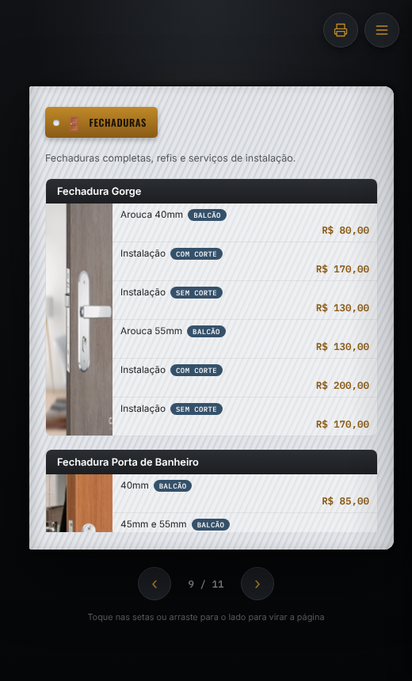
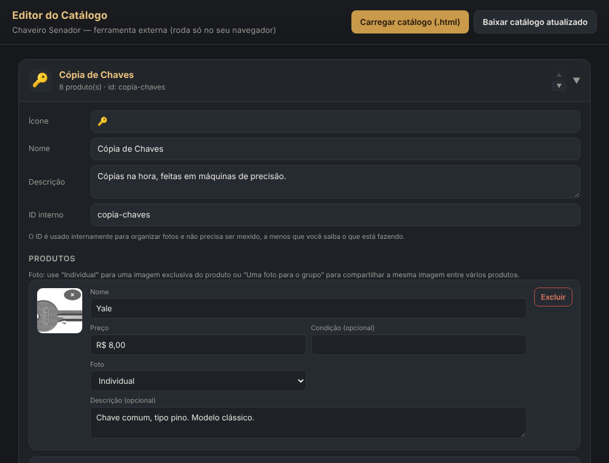

# Como usar

Guia para quem vai **mostrar** o catálogo e para quem vai **atualizar** produtos, preços e fotos.

## 1. Mostrar o catálogo

Abra `dist/catalogo-chaveiro-senador.html` no navegador do celular ou do computador. Não precisa de internet; só as fontes vêm do Google quando há conexão.

 

| Para | Faça |
| --- | --- |
| Virar a página | Setas ‹ › embaixo, setas ← → do teclado ou arrastar para o lado no celular |
| Ir direto a uma categoria | Toque nela no **Índice** (página 2) ou abra o menu **☰** |
| Imprimir ou gerar PDF | Botão da impressora (canto superior direito): cada página vira uma folha A4 |
| Mandar para um cliente | Envie o próprio arquivo `.html` por WhatsApp ou e-mail; ele abre no navegador |

## 2. Atualizar produtos, preços e fotos (editor)



1. Abra `editor/index.html` no navegador. Para usar em outro computador sem a pasta, use `dist/editor-catalogo.html`, que é o mesmo editor em um arquivo.
2. Clique em **Carregar catálogo (.html)** e escolha `dist/catalogo-chaveiro-senador.html`.
3. Clique no nome de uma categoria para abri-la e editar:

| Quero | Como |
| --- | --- |
| Mudar nome, preço, condição ou descrição | Digite no campo. Campo vazio é removido do catálogo |
| Trocar ou adicionar a foto de um produto | Clique na caixa da foto e escolha a imagem |
| Tirar a foto de um produto | Clique no **×** da foto. No catálogo aparece o ícone da categoria |
| Usar a mesma foto para vários produtos | No campo **Foto**, escolha "Uma foto para o grupo" e dê o mesmo nome de grupo a todos |
| Novo produto | **+ Adicionar produto com foto individual** ou **+ Adicionar produto sem foto / do grupo** |
| Mudar a ordem das páginas | Setas ▲ ▼ no cabeçalho da categoria |
| Nova categoria | **+ Adicionar nova categoria**, no fim da lista: o editor pergunta nome, emoji e descrição |
| Fechaduras: foto do modelo | **Escolher foto** ao lado do nome do grupo |
| Fechaduras: tamanho da foto | **Tamanho da foto no catálogo**: Padrão, Pequena, Média ou Grande |
| Fechaduras: foto própria de um item | **Escolher foto** na linha do item; ela aparece pequena ao lado do item |

4. Clique em **Baixar catálogo atualizado**. O arquivo baixado, `catalogo-chaveiro-senador-AAAA-MM-DD.html`, **já é o catálogo novo**.

> As edições ficam só na memória do navegador. Se fechar a aba sem baixar, elas se perdem. O editor avisa antes de fechar.

## 3. Registrar a mudança no projeto (Git)

Para o código-fonte (`src/`) continuar sendo a versão oficial, importe o arquivo baixado:

```bash
npm run importar -- "C:\Users\voce\Downloads\catalogo-chaveiro-senador-2026-10-25.html"
npm run build
git add -A
git commit -m "Atualiza preços de fechaduras"
```

O que a importação faz:

| No arquivo baixado | Vai para |
| --- | --- |
| Categorias e produtos | `src/dados/categorias.json` |
| Fotos novas ou trocadas | `src/imagens/custom/` (um arquivo por foto) |
| Fotos removidas | `src/dados/fotos-ocultas.json` |
| Tamanho das fotos de grupo | `src/dados/tamanhos-grupos.json` |

Depois do `npm run build`, o `dist/` fica igual ao arquivo que você baixou. Com `git diff` você vê exatamente o que mudou: preços no JSON e fotos novas como arquivos.

## 4. Mudanças que não são feitas pelo editor

| Quero mudar | Arquivo |
| --- | --- |
| Nome da loja ou subtítulo da capa | `src/dados/config.json` |
| Logo da capa | Troque `src/imagens/logo.png` (mesmo nome) |
| Cores, fontes, tamanhos | `src/css/catalogo.css` (seção 1 tem as cores) |
| Tamanho ou enquadramento de uma foto específica | `src/css/ajustes-fotos.css` |
| Uma foto original de categoria | Troque o arquivo em `src/imagens/<pasta>/` (mesmo nome e formato) |

Depois de qualquer mudança em `src/`, rode `npm run build`.
